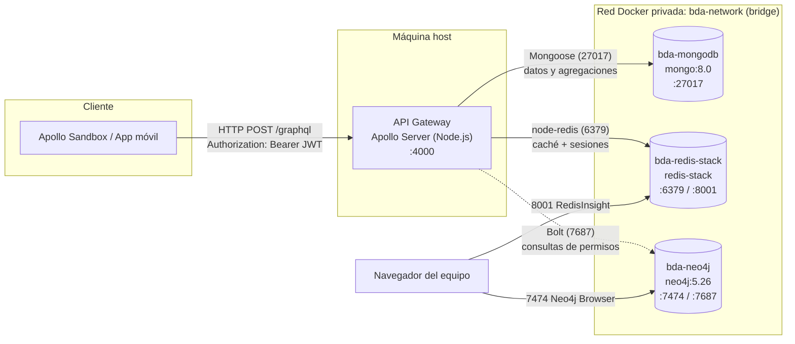
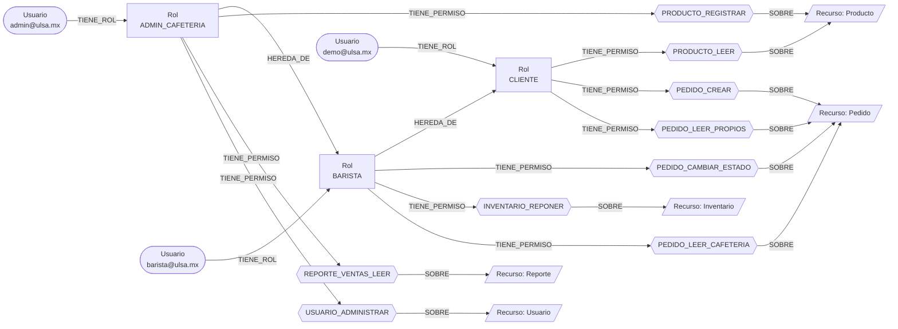

# Pide y Recoge — Documentación técnica del Segundo Parcial

**Materia:** Bases de Datos Avanzadas
**Proyecto integrador:** *Pide y Recoge*, una app para pedir comida en la cafetería de la escuela y recogerla sin hacer fila.

| Apellido paterno | Apellido materno | Nombre(s) | Matrícula |
|---|---|---|---|
|  |  |  |  |
|  |  |  |  |
|  |  |  |  |

---

## Índice

- [A. Sección teórica](#a-sección-teórica)
  - [1. Arquitectura y topología de contenedores (Docker)](#1-arquitectura-y-topología-de-contenedores-docker)
  - [2. Modelo de autorización basado en grafos (RBAC con Neo4j y Cypher)](#2-modelo-de-autorización-basado-en-grafos-rbac-con-neo4j-y-cypher)
  - [3. Justificación de paradigmas NoSQL](#3-justificación-de-paradigmas-nosql)
- [B. Sección práctica](#b-sección-práctica)
  - [1. Capa de velocidad: Redis y Cache-Aside](#1-capa-de-velocidad-redis-y-patrón-cache-aside)
  - [2. Autenticación híbrida: JWT y sesiones con TTL en Redis](#2-autenticación-híbrida-jwt-y-sesiones-con-ttl-en-redis)
  - [3. API Gateway (GraphQL) y persistencia (MongoDB)](#3-api-gateway-graphql-y-persistencia-transaccional-mongodb)
- [C. Guía de la demostración en vivo](#c-guía-de-la-demostración-en-vivo)
- [D. Relación con la rúbrica](#d-relación-con-la-rúbrica)

---

# A. Sección teórica

## 1. Arquitectura y topología de contenedores (Docker)

La infraestructura se levanta con `docker compose up -d` usando el archivo [`docker-compose.yml`](../docker-compose.yml). Hay tres contenedores, uno por motor, conectados a la red privada **`bda-network`**, que usa el driver `bridge`. La API GraphQL (Apollo Server) corre en la máquina del desarrollador y llega a cada motor por los puertos publicados en `localhost`.

### Diagrama de topología



Versión en texto, por si el visor no muestra Mermaid:

```
                 ┌──────────────────────── Máquina host ─────────────────────────┐
 Apollo Sandbox  │  ┌───────────────────────┐                                    │
 ──HTTP :4000──► │  │ API Gateway (Apollo)  │                                    │
 Bearer <JWT>    │  └──┬─────────┬────────┬─┘                                    │
                 │     │27017    │6379    │7687                                  │
                 │ ┌───┼─────────┼────────┼──── red privada bda-network ───────┐  │
                 │ │ ┌─▼──────────┐ ┌─▼───────────────┐ ┌─▼──────────┐        │  │
                 │ │ │bda-mongodb │ │bda-redis-stack  │ │ bda-neo4j  │        │  │
                 │ │ │  :27017    │ │ :6379  :8001    │ │:7474 :7687 │        │  │
                 │ │ └────────────┘ └─────────────────┘ └────────────┘        │  │
                 │ └──────────────────────────────────────────────────────────┘  │
                 └───────────────────────────────────────────────────────────────┘
```

### Puertos y servicios

| Contenedor | Imagen | Puerto | Protocolo / función |
|---|---|---|---|
| `bda-mongodb` | `mongo:8.0` | **27017** | Protocolo nativo de MongoDB. Lo usa Mongoose para leer, escribir y ejecutar agregaciones. |
| `bda-redis-stack` | `redis/redis-stack` | **6379** | Protocolo RESP de Redis. Lo usa `node-redis` para la caché (`GET`/`SET EX`/`DEL`) y las sesiones (`sesion:<jti>`). |
| `bda-redis-stack` | `redis/redis-stack` | **8001** | **RedisInsight**, la interfaz web para inspeccionar claves, ver los TTL y ejecutar comandos. |
| `bda-neo4j` | `neo4j:5.26` | **7474** | **Neo4j Browser** (HTTP), la interfaz web para ejecutar Cypher y ver el grafo RBAC. |
| `bda-neo4j` | `neo4j:5.26` | **7687** | Protocolo **Bolt**, binario, por el que se conectan los drivers (`neo4j-driver`, `cypher-shell`). |

### Red y persistencia

- **Red privada `bda-network` (bridge):** Docker crea un segmento de red virtual aislado y un DNS interno. Dentro de la red, cada contenedor encuentra a los demás por su nombre de servicio (`mongodb`, `redis-stack`, `neo4j`) sin exponer su IP. Desde fuera, solo se alcanzan los puertos publicados con `ports:`.
- **Volúmenes nombrados** (`mongodb_data`, `redis_data`, `neo4j_data`): los datos sobreviven a `docker compose down` y a los reinicios. Solo se pierden con `docker compose down -v`.
- **Credenciales de desarrollo:** MongoDB `admin/password123`, Redis `requirepass password123`, Neo4j `neo4j/password123`. En producción irían en variables de entorno o secretos, nunca en el repositorio.
- **`restart: unless-stopped`:** si Docker se reinicia, los contenedores vuelven a levantarse solos.

---

## 2. Modelo de autorización basado en grafos (RBAC con Neo4j y Cypher)

El script completo y ejecutable está en [`neo4j/rbac.cypher`](../neo4j/rbac.cypher).

### Diseño del grafo de permisos

**Nodos**

| Etiqueta | Propiedades | Ejemplos |
|---|---|---|
| `:Usuario` | `id` (el `_id` de MongoDB), `correo` | `demo@ulsa.mx` |
| `:Rol` | `nombre`, `descripcion` | `CLIENTE`, `BARISTA`, `ADMIN_CAFETERIA` |
| `:Permiso` | `clave`, `accion` | `PEDIDO_CREAR` (CREAR), `REPORTE_VENTAS_LEER` (LEER) |
| `:Recurso` | `nombre` | `Producto`, `Inventario`, `Pedido`, `Reporte`, `Usuario` |

**Relaciones**

| Relación | Significado |
|---|---|
| `(:Usuario)-[:TIENE_ROL]->(:Rol)` | El usuario tiene asignado ese rol. |
| `(:Rol)-[:TIENE_PERMISO]->(:Permiso)` | El rol otorga ese permiso de forma directa. |
| `(:Permiso)-[:SOBRE]->(:Recurso)` | Recurso sobre el que actúa el permiso. |
| `(:Rol)-[:HEREDA_DE]->(:Rol)` | **Jerarquía:** un rol recibe todos los permisos del rol del que hereda. |



Gracias a `HEREDA_DE`, cada permiso se asigna una sola vez. Un `ADMIN_CAFETERIA` puede crear pedidos porque hereda de `BARISTA`, que a su vez hereda de `CLIENTE`, sin duplicar la relación `TIENE_PERMISO`.

### Consultas en Cypher

**Restricciones de unicidad.** Evitan duplicados y además crean un índice que acelera el punto de entrada de cada consulta.

```cypher
CREATE CONSTRAINT usuario_id_unico     IF NOT EXISTS FOR (u:Usuario) REQUIRE u.id IS UNIQUE;
CREATE CONSTRAINT usuario_correo_unico IF NOT EXISTS FOR (u:Usuario) REQUIRE u.correo IS UNIQUE;
CREATE CONSTRAINT rol_nombre_unico     IF NOT EXISTS FOR (r:Rol)     REQUIRE r.nombre IS UNIQUE;
CREATE CONSTRAINT permiso_clave_unica  IF NOT EXISTS FOR (p:Permiso) REQUIRE p.clave IS UNIQUE;
CREATE CONSTRAINT recurso_nombre_unico IF NOT EXISTS FOR (r:Recurso) REQUIRE r.nombre IS UNIQUE;
```

**Asignar un rol a un usuario**

```cypher
MATCH (u:Usuario {correo: "demo@ulsa.mx"}), (r:Rol {nombre: "CLIENTE"})
MERGE (u)-[:TIENE_ROL]->(r);
```

**Verificar una ruta de permisos.** Esta consulta responde la pregunta "¿el usuario puede hacer X?". El patrón `HEREDA_DE*0..` recorre de cero a N niveles de la jerarquía de roles. Si devuelve `true` la API autoriza; si devuelve `false` responde **403 Forbidden**.

```cypher
MATCH (u:Usuario {correo: "admin@ulsa.mx"})
RETURN EXISTS {
  (u)-[:TIENE_ROL]->(:Rol)-[:HEREDA_DE*0..]->(:Rol)
     -[:TIENE_PERMISO]->(:Permiso {clave: "PEDIDO_CREAR"})
} AS autorizado;      // -> true (heredado de CLIENTE)
```

```cypher
MATCH (u:Usuario {correo: "demo@ulsa.mx"})
RETURN EXISTS {
  (u)-[:TIENE_ROL]->(:Rol)-[:HEREDA_DE*0..]->(:Rol)
     -[:TIENE_PERMISO]->(:Permiso {clave: "REPORTE_VENTAS_LEER"})
} AS autorizado;      // -> false (un CLIENTE no ve reportes)
```

**Permisos efectivos de un usuario y el rol que los otorga**

```cypher
MATCH (u:Usuario {correo: "barista@ulsa.mx"})-[:TIENE_ROL]->(rolDirecto:Rol)
MATCH (rolDirecto)-[:HEREDA_DE*0..]->(rol:Rol)-[:TIENE_PERMISO]->(p:Permiso)-[:SOBRE]->(rec:Recurso)
RETURN p.clave AS permiso, p.accion AS accion, rec.nombre AS recurso, rol.nombre AS otorgadoPor
ORDER BY recurso, permiso;
```

**Ruta completa que justifica un acceso** (se ve como grafo en Neo4j Browser)

```cypher
MATCH ruta = (u:Usuario {correo: "admin@ulsa.mx"})-[:TIENE_ROL]->(:Rol)
             -[:HEREDA_DE*0..]->(:Rol)-[:TIENE_PERMISO]->(:Permiso {clave: "PEDIDO_CREAR"})
             -[:SOBRE]->(:Recurso)
RETURN ruta;
```

**Consulta inversa: quién puede reponer inventario**

```cypher
MATCH (p:Permiso {clave: "INVENTARIO_REPONER"})<-[:TIENE_PERMISO]-(:Rol)
      <-[:HEREDA_DE*0..]-(:Rol)<-[:TIENE_ROL]-(u:Usuario)
RETURN DISTINCT u.correo AS usuario;     // barista@ulsa.mx, admin@ulsa.mx
```

### Index-Free Adjacency

Neo4j es una base de datos de **grafos nativa** y almacena sus datos con *index-free adjacency*: cada nodo guarda punteros físicos directos a sus relaciones, y cada relación guarda punteros a su nodo origen y a su nodo destino. Por eso, pasar de un nodo a su vecino cuesta **O(1)** y no requiere consultar ningún índice global.

En una base relacional, la misma verificación (`usuarios ⋈ usuario_rol ⋈ roles ⋈ rol_hereda ⋈ rol_permiso ⋈ permisos`) necesita un `JOIN` por cada salto. Cada `JOIN` busca en un índice B-tree con costo **O(log n)**, que crece con el tamaño de **toda la tabla**. Además, la jerarquía de profundidad variable exige un `WITH RECURSIVE`.

En Neo4j, el índice de la restricción de unicidad solo se usa una vez, para encontrar el nodo de partida (`Usuario {correo}`). A partir de ahí la consulta solo recorre punteros, y su costo depende del **número de relaciones que realmente toca**, no del total de usuarios o permisos almacenados. Así, la autorización mantiene una latencia estable aunque el sistema crezca a muchas escuelas, cafeterías y usuarios.

---

## 3. Justificación de paradigmas NoSQL

**MongoDB: persistencia transaccional y fuente de verdad histórica.** Es la base donde viven de forma permanente las escuelas, cafeterías, usuarios, productos y pedidos. Su modelo documental encaja con el dominio: un `Pedido` guarda incrustados sus `items` con el precio congelado al momento de la compra, así que el historial de ventas no cambia aunque después cambie el precio del producto. MongoDB ofrece transacciones ACID multi-documento (en replica set, como Atlas): `crearPedido` descuenta el stock de varios productos y crea el pedido en una sola transacción que se revierte si falta inventario. Su *aggregation pipeline* (`$match` → `$unwind` → `$group` → `$sort`) genera el reporte de productos más vendidos directamente en la base, sin traer los datos a la aplicación. Además, Mongoose aplica un esquema con validaciones (stock entero y no negativo, moneda ISO de 3 letras), lo que da flexibilidad sin perder integridad.

**Redis Stack: caché de lectura de alta velocidad y estado temporal de las sesiones.** Redis guarda los datos en memoria RAM con estructuras clave-valor, así que responde en menos de un milisegundo, contra los 10 a 20 ms de una consulta a MongoDB. Se usa en dos papeles. Primero, como **caché Cache-Aside** de las lecturas más frecuentes (menú de la cafetería, catálogos, reporte de ventas), lo que quita carga a MongoDB en horas pico, cuando todos los alumnos abren el menú al mismo tiempo. Segundo, como **almacén de sesiones** (`sesion:<jti>`). Su **TTL nativo** (`SET ... EX`) hace que la sesión expire sola, sin procesos de limpieza, y `DEL` permite revocar un JWT al instante. Esto resuelve la mayor debilidad de los JWT, que por sí solos no se pueden invalidar antes de su expiración. Ninguno de estos datos necesita durabilidad: si se pierden, la caché se reconstruye desde MongoDB y el usuario solo vuelve a iniciar sesión.

**Neo4j: representación y evaluación de permisos con relaciones jerárquicas.** La autorización es, por naturaleza, un problema de relaciones: un usuario tiene roles, los roles heredan de otros roles, otorgan permisos y los permisos actúan sobre recursos. En un modelo relacional o documental, esto se traduce en JOINs recursivos o en duplicar permisos en cada usuario. En Neo4j es simplemente el grafo, y la pregunta "¿puede este usuario hacer X?" es la búsqueda de una ruta. Gracias a *index-free adjacency*, recorrer la jerarquía de roles (`HEREDA_DE*0..`) tiene un costo proporcional a la profundidad de la ruta y no al tamaño de la base. Además, agregar un rol nuevo (por ejemplo, `SUPERVISOR_ESCUELA` que hereda de `ADMIN_CAFETERIA`) consiste en crear un nodo y una relación, sin migrar esquemas ni modificar el código de la API.

---

# B. Sección práctica

## 1. Capa de velocidad: Redis y patrón Cache-Aside

**Archivos:** [`src/infrastructure/redis.js`](../src/infrastructure/redis.js) (cliente) y [`src/infrastructure/cache.js`](../src/infrastructure/cache.js) (patrón).

```js
export async function obtenerConCache(clave, cargarDesdeMongo, ttl = CACHE_TTL_SEGUNDOS) {
  const inicioRedis = performance.now();
  const enCache = await redisClient.get(clave);              // 1. buscar en Redis
  const latenciaRedis = performance.now() - inicioRedis;

  if (enCache !== null) {                                     // 2. HIT
    console.log(`[CACHE HIT ] ${clave} -> Redis: ${ms(latenciaRedis)} ms`);
    return JSON.parse(enCache);
  }

  const inicioMongo = performance.now();
  const datos = await cargarDesdeMongo();                     // 3. MISS -> MongoDB
  const latenciaMongo = performance.now() - inicioMongo;

  await redisClient.set(clave, JSON.stringify(datos), { EX: ttl });   // SET ... EX
  console.log(`[CACHE MISS] ${clave} -> MongoDB: ${ms(latenciaMongo)} ms ...`);
  return datos;
}
```

**Consultas con caché** (en `src/resolvers/index.js`):

| Query | Clave en Redis |
|---|---|
| `productosPorCafeteria` | `cache:productos:cafeteria:<id>` |
| `producto` | `cache:producto:<id>` |
| `productosPorReponer` | `cache:productos:reponer:<id>` |
| `productosMasVendidos` (agregación) | `cache:reporte:masvendidos:<id>` |
| `monedas`, `estadosPedido` | `cache:catalogo:monedas`, `cache:catalogo:estados` |

**Invalidación (`redisClient.del`) después de cada escritura:**

| Mutation | Claves que se borran |
|---|---|
| `registrarProducto` | productos de la cafetería y productos por reponer |
| `reponerInventario` | las anteriores y además el producto |
| `crearPedido` | las anteriores para cada producto del pedido (cambió el stock) |
| `actualizarEstadoPedido` | reporte de más vendidos (cuenta pedidos `ENTREGADO`) |
| `registrarMoneda` | catálogo de monedas |

**Medición de latencia.** Se usa `performance.now()`. Esta es una salida real de la consola:

```
[CACHE MISS] cache:productos:cafeteria:6ad6...cd1c -> MongoDB: 11.361 ms (guardado en Redis con TTL de 60 s)
[CACHE HIT ] cache:productos:cafeteria:6ad6...cd1c -> Redis: 0.908 ms
[CACHE MISS] cache:reporte:masvendidos:6ad6...cd1c -> MongoDB: 17.714 ms (guardado en Redis con TTL de 60 s)
[CACHE HIT ] cache:reporte:masvendidos:6ad6...cd1c -> Redis: 0.363 ms
[CACHE DEL ] cache:productos:cafeteria:..., cache:productos:reponer:..., cache:producto:... (1 clave(s) eliminada(s))
```

Las lecturas desde Redis quedan **por debajo de 1.5 ms**.

## 2. Autenticación híbrida: JWT y sesiones con TTL en Redis

**Archivo:** [`src/infrastructure/auth.js`](../src/infrastructure/auth.js)

- **Registro** (`mutation registrarUsuario`): normaliza nombre y correo, valida el formato del correo, exige una contraseña de al menos 6 caracteres y verifica que la cafetería exista y esté activa. La contraseña se guarda únicamente como hash bcrypt; el correo tiene índice único en MongoDB.
- **Login** (`mutation login(correo, password)`): compara la contraseña con su hash `bcrypt` guardado en MongoDB. Si coincide, firma un JWT con `jti = crypto.randomUUID()` y registra la sesión:
  ```
  SET sesion:<jti> <userId> EX 3600
  ```
- **Logout** (`mutation logout`): ejecuta `DEL sesion:<jti>`. El token queda **revocado de inmediato**, aunque su firma y su fecha de expiración sigan siendo válidas.
- **Contexto de GraphQL (middleware):** `construirContexto` corre en **cada petición** antes de los resolvers.
  1. Si la petición no trae `Authorization`, sigue como anónima (sirve para `login` y para consultas públicas).
  2. Si lo trae, revisa el formato `Bearer <token>` y verifica la **firma criptográfica** con `jwt.verify`.
  3. Comprueba que `sesion:<jti>` **siga existiendo en Redis** y que corresponda al mismo usuario.
  4. Si cualquiera de estas validaciones falla, **se rechaza toda la petición** con `UNAUTHENTICATED` y **HTTP 401**.
- **`query me`** está protegida: sin una sesión válida responde 401.

Para registrar una cuenta, primero consulta `cafeterias` y utiliza el `id` de una cafetería activa. Después inicia sesión con el correo y la contraseña registrados:

```graphql
mutation {
  registrarUsuario(
    nombre: "Ana Ejemplo"
    correo: "ana@ejemplo.mx"
    password: "clave123"
    cafeteriaId: "ID_DE_CAFETERIA"
  ) {
    id
    nombre
    correo
    cafeteriaId
  }
}
```

La respuesta no incluye la contraseña ni su hash. El registro y el inicio de sesión son operaciones separadas: tras el registro, ejecuta `login(correo, password)` para recibir el token de sesión.

```js
const usuarioEnSesion = await redisClient.get(`sesion:${payload.jti}`);
if (usuarioEnSesion === null || usuarioEnSesion !== payload.sub) {
  throw noAutorizado("La sesion fue cerrada o expiro. Inicia sesion de nuevo.");  // HTTP 401
}
```

## 3. API Gateway (GraphQL) y persistencia transaccional (MongoDB)

- **SDL:** [`src/schema.graphql`](../src/schema.graphql). Define los tipos (`Escuela`, `Cafeteria`, `Usuario`, `Producto`, `Inventario`, `Pedido`, `Dinero`, `SesionPayload`...), los `input`, las **Queries** (`me`, `productosPorCafeteria`, `productosPorReponer`, `pedidosPorUsuario`, `productosMasVendidos`...) y las **Mutations** (`login`, `logout`, `registrarUsuario`, `registrarProducto`, `reponerInventario`, `crearPedido`, `actualizarEstadoPedido`...).
- **Resolvers:** [`src/resolvers/index.js`](../src/resolvers/index.js). Validan las reglas de dominio ([`src/domain/entities.js`](../src/domain/entities.js)) antes de persistir con los modelos de Mongoose ([`src/infrastructure/mongoose-models.js`](../src/infrastructure/mongoose-models.js)).
- **Transacción:** `crearPedido` usa `session.withTransaction`. Descuenta stock con `$inc` condicionado (`stock >= cantidad`) y crea el pedido. Si algo falla, se revierte todo.
- **Agregación (reporte analítico):** `productosMasVendidos(cafeteriaId)`.

```js
PedidoModel.aggregate([
  { $match: { cafeteriaId, estado: "ENTREGADO" } },          // solo ventas completadas de ESA cafetería
  { $unwind: "$items" },                                      // un documento por item
  { $group: {
      _id: { nombreProducto: "$items.nombreProducto", moneda: "$items.precioUnitario.moneda" },
      unidadesVendidas: { $sum: "$items.cantidad" },
      ingresosTotales:  { $sum: { $multiply: ["$items.cantidad", "$items.precioUnitario.monto"] } }
  }},
  { $sort: { unidadesVendidas: -1 } }                         // del más vendido al menos vendido
]);
```

El reporte le dice a la cafetería qué productos vender más y cuánto dinero generan, separado por moneda para no sumar pesos con dólares.

---

# C. Guía de la demostración en vivo

### Preparación

```bash
docker compose up -d        # bda-mongodb, bda-redis-stack, bda-neo4j
npm install
npm run seed                # catálogos + cafetería demo + usuario demo@ulsa.mx / demo123
npm run dev                 # http://localhost:4000 (Apollo Sandbox)
docker exec -i bda-neo4j cypher-shell -u neo4j -p password123 < neo4j/rbac.cypher
```

`npm run seed` imprime el `id` de la cafetería demo; ese valor se usa como `cafeteriaId` en los pasos siguientes.

### 1) Arquitectura

- `docker ps` muestra los 3 contenedores y sus puertos.
- `docker network inspect basededatosavanzadas_bda-network` muestra los 3 contenedores en la misma red.
- RedisInsight en <http://localhost:8001> y Neo4j Browser en <http://localhost:7474> (`neo4j` / `password123`). En Neo4j Browser se ejecutan las consultas A–E de `neo4j/rbac.cypher`.

### 2) Caché (dos lecturas del mismo recurso)

En Apollo Sandbox se ejecuta **dos veces**:

```graphql
query {
  productosPorCafeteria(cafeteriaId: "<ID_CAFETERIA>") {
    nombre
    precio { monto moneda }
    inventario { stock requiereReposicion }
  }
}
```

En la consola de `npm run dev` debe aparecer primero `[CACHE MISS] ... MongoDB: ~10 ms` y después `[CACHE HIT ] ... Redis: <1.5 ms`.

Para mostrar la invalidación, se ejecuta `reponerInventario(productoId: "...")`. En la consola aparece `[CACHE DEL ]`, y la siguiente lectura vuelve a ser `MISS` con el stock nuevo.

### 3) Revocación del JWT

1. **Login** (se copia el `token` de la respuesta):
   ```graphql
   mutation {
     login(correo: "demo@ulsa.mx", password: "demo123") {
       token
       expiraEn
       usuario { nombre correo }
     }
   }
   ```
2. En la pestaña **Headers** de Sandbox se agrega `Authorization: Bearer <token>` y se ejecuta:
   ```graphql
   query { me { id nombre correo } }
   ```
   La respuesta es exitosa (HTTP 200).
3. Con el mismo encabezado:
   ```graphql
   mutation { logout }
   ```
   Responde `true`. En la consola aparece `[SESION] DEL sesion:<jti>` y en RedisInsight la clave ya no existe.
4. Se repite `query { me { ... } }` con **el mismo token**. Ahora la respuesta es `UNAUTHENTICATED` con **HTTP 401**: *"La sesion fue cerrada o expiro"*.

---

# D. Relación con la rúbrica

| Criterio (3 pts c/u) | Dónde se cubre |
|---|---|
| Arquitectura de contenedores (Docker) | `docker-compose.yml`, sección A.1 |
| RBAC y consultas en Cypher (Neo4j) | `neo4j/rbac.cypher`, sección A.2 |
| Justificación de paradigmas NoSQL | Sección A.3 |
| API Gateway GraphQL: SDL, queries, mutations, resolvers | `src/schema.graphql`, `src/resolvers/index.js`, sección B.3 |
| Persistencia y consultas avanzadas (Mongoose) | `mongoose-models.js`, transacción en `crearPedido`, agregación `productosMasVendidos` |
| Cache-Aside, invalidación y latencias (Redis) | `src/infrastructure/cache.js`, sección B.1 |
| JWT, Redis TTL y logout | `src/infrastructure/auth.js`, mutations `login`/`logout` |
| Middleware de contexto y rechazo de tokens revocados | `construirContexto` en `auth.js` (conectado en `src/index.js`) |
