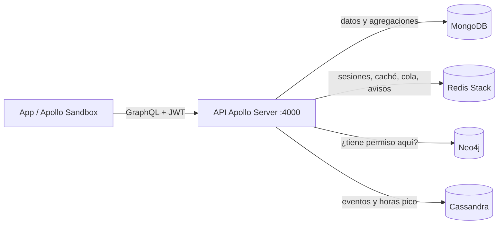
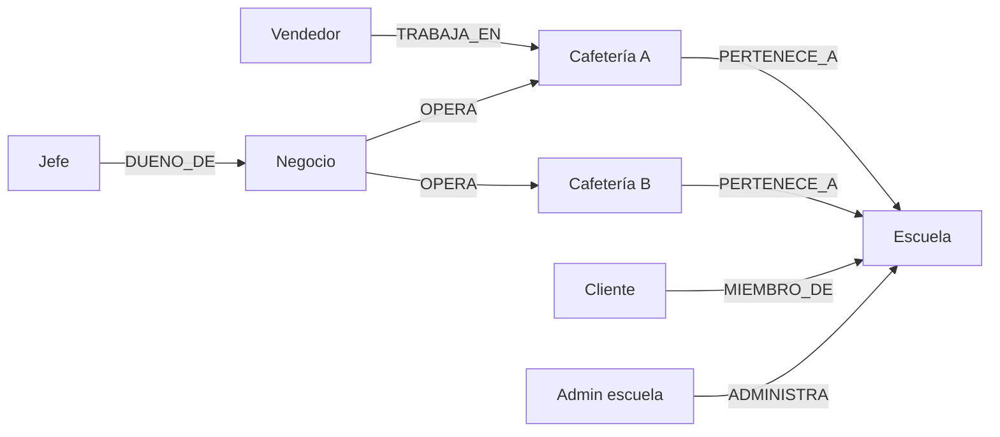

# CafeEnLinea multiempresa: guía técnica

CafeEnLinea es una plataforma *pickup* para cafeterías escolares. Cualquier escuela se registra sola, invita a los negocios de su campus y sus alumnos piden desde el catálogo, sin hacer fila. Cada escuela es un *tenant*: sus datos nunca se mezclan con los de otra.

## 1. Cuatro bases de datos, cada una con un trabajo

| Motor | Contenedor | Para qué se usa | Por qué ese motor |
|---|---|---|---|
| **MongoDB** | `bda-mongodb` (o Atlas) | Fuente de verdad: escuelas, negocios, cafeterías, usuarios, menú, pedidos. Transacciones al crear y cancelar pedidos. Reportes con pipelines de agregación. | Documentos flexibles (un pedido trae sus items y su historial) y transacciones ACID. |
| **Redis Stack** | `bda-redis-stack` | Sesiones JWT con TTL, caché *cache-aside* del menú y reportes, caché de permisos, cola de cocina por cafetería, avisos al comprador (lista + Pub/Sub). | Lecturas en microsegundos, TTL nativo y estructuras como Sorted Set y Hash. |
| **Neo4j** | `bda-neo4j` | Grafo de permisos: quién puede hacer qué, y **dónde** (en qué escuela, negocio o cafetería). | La pregunta "¿este usuario llega a esta cafetería?" es un recorrido de grafo. |
| **Cassandra** | `bda-cassandra` | Bitácora de eventos de cada pedido y contadores de ventas por hora (horas pico). | Muchas escrituras que solo se agregan y siempre se consultan por la misma llave. |



## 2. Roles

| Rol | Quién es | Qué puede hacer |
|---|---|---|
| `ADMIN_PLATAFORMA` | Equipo de CafeEnLinea | Suspender o reactivar escuelas, registrar monedas. |
| `ADMIN_ESCUELA` | Encargado de la escuela | Ver y regenerar el código de invitación, ver el reporte de su escuela. |
| `JEFE` | Dueño de un negocio | Abrir cafeterías, dar de alta vendedores, ver reportes de su negocio. Hereda todo lo de `VENDEDOR`. |
| `VENDEDOR` | Atiende **una** cafetería | Agregar y editar platillos, cambiar estados de pedidos, reponer inventario. Hereda lo de `CLIENTE`. |
| `CLIENTE` | Alumno o maestro | **Solo compra**: ve el catálogo, pide, cancela mientras esté pendiente. |

Los permisos se definen en `neo4j/rbac.cypher`. Cada permiso tiene un **alcance**:

- `COMPRA`: el usuario es `MIEMBRO_DE` la escuela de la cafetería.
- `GESTION`: `TRABAJA_EN` la cafetería, es `DUENO_DE` su negocio o `ADMINISTRA` su escuela.
- `PLATAFORMA`: solo `ADMIN_PLATAFORMA`.



Cada respuesta de Neo4j se guarda en Redis (`permiso:<usuario>:<permiso>:<alcance>`, 5 min) y se borra cuando cambian las relaciones del usuario.

## 3. Flujo multiempresa

1. **La escuela se registra** con `registrarEscuela`. Se crea su `ADMIN_ESCUELA` y un **código de invitación** (ej. `ULSA-4F9A2C`).
2. **El dueño de una cafetería** usa ese código en `registrarNegocio`. Se crean su negocio y su cuenta `JEFE`.
3. El jefe **abre cafeterías** (`registrarCafeteria`) y **da de alta vendedores** (`registrarVendedor`). Con el código de otra escuela puede llevar su negocio ahí también (`unirNegocioAEscuela`).
4. Los **vendedores arman el menú** (`registrarProducto`, `actualizarProducto`, `cambiarDisponibilidadProducto`). Las imágenes son URLs de Cloudinary.
5. Los **compradores** eligen su escuela en `catalogoEscuelas`, se registran (`registro`) y ven cafeterías y menús (`cafeteriasPorEscuela`, `menuPorCategoria`).

## 4. Flujo pickup

```
PENDIENTE → ACEPTADO → EN_PREPARACION → LISTO → ENTREGADO
    └──────────┴──→ CANCELADO (regresa el stock)
```

- **Hora de recogida.** Tiempo = platillo más lento + 1 min por pieza extra + espera de la cola de cocina. La espera es la suma de los minutos en cola entre `CAPACIDAD_PARALELA`, que por defecto es 2. El comprador puede elegir una hora posterior, hasta 12 h después.
- **Cola de cocina en Redis.** `cola:<cafeteria>` es un Sorted Set que guarda el orden y `cola:<cafeteria>:min` es un Hash con los minutos de cada pedido. El pedido sale de la cola al quedar `LISTO`.
- **Código de recogida** de 4 dígitos. Solo lo ve el comprador, y el vendedor lo pide para marcar `ENTREGADO`.
- **Avisos.** Cada cambio de estado se agrega a `notificaciones:<usuario>` (query `misNotificaciones`) y se publica en el canal `pedidos:usuario:<id>`.
- **Bitácora en Cassandra.** Cada evento se escribe en `eventos_por_pedido` y `eventos_por_cafeteria_dia`. Las ventas por hora se suman en contadores de `ventas_por_hora`.

## 5. Cómo levantarlo

Variables nuevas en `.env` (además de las que ya tenían):

```
NEO4J_PASSWORD=<la misma de NEO4J_AUTH en docker-compose.yml>
# Opcionales (estos son los valores por defecto)
NEO4J_URI=bolt://localhost:7687
NEO4J_USER=neo4j
CASSANDRA_CONTACT_POINTS=localhost:9042
CASSANDRA_DATACENTER=datacenter1
ZONA_HORARIA=America/Chihuahua
CAPACIDAD_PARALELA=2
PERMISO_TTL_SEGUNDOS=300
```

```bash
docker compose up -d     # Cassandra tarda ~1 minuto la primera vez
npm install
npm run seed             # catálogos, datos demo, migración y grafo de Neo4j
npm run dev              # http://localhost:4000
npm run grafo            # (opcional) reconstruye el grafo de Neo4j desde MongoDB
```

Si Cassandra no está arriba, la API funciona igual: solo se omiten los eventos y los reportes de Cassandra responden con error.

### Usuarios demo (contraseña `demo123`)

| Rol | Correo | Dónde |
|---|---|---|
| ADMIN_PLATAFORMA | `admin@cafeenlinea.mx` | — |
| ADMIN_ESCUELA | `admin@ulsa.mx` / `admin@tec.mx` | ULSA / TEC |
| JEFE | `jefe@ulsa.mx` | Los Latosos del Chef: 3 cafeterías en ULSA + 1 en TEC |
| JEFE | `lupe@ulsa.mx` | Tortas Lupe (ULSA) |
| VENDEDOR | `vendedor@ulsa.mx` | Cafetería Los Latosos del Chef ULSA |
| VENDEDOR | `vendedor.norte@ulsa.mx` | Latosos Norte (sin molletes, para probar `dondeHay`) |
| VENDEDOR | `vendedor.tec@tec.mx` / `vendedor.lupe@ulsa.mx` | Latosos TEC / Tortas Lupe |
| CLIENTE | `demo@ulsa.mx` / `alumno@tec.mx` | ULSA / TEC |

## 6. Guion de demo (Apollo Sandbox)

Inicia sesión con `login` y manda `Authorization: Bearer <token>` en los encabezados.

**Comprador:** catálogo, estimación y pedido

```graphql
query { catalogoEscuelas(busqueda: "ulsa") { id nombre cafeterias { id nombre ubicacion negocio { nombre } } } }

query ($caf: ID!) { menuPorCategoria(cafeteriaId: $caf) { categoria productos { id nombre precio { monto } agotado tiempoPreparacionMin imagenUrl } } }

query ($caf: ID!, $items: [ItemPedidoInput!]!) { estimarRecogida(cafeteriaId: $caf, items: $items) { tiempoEstimadoMin horaRecogida pedidosEnCola } }

mutation ($caf: ID!, $items: [ItemPedidoInput!]!) {
  crearPedido(cafeteriaId: $caf, items: $items, notas: "Sin cebolla") {
    id estado total { monto } horaRecogida codigoRecogida posicionEnCola
  }
}

query { misNotificaciones { estado mensaje fecha } }
```

**Prueba de permisos:** con el token del comprador, `registrarProducto` responde **403 FORBIDDEN**. Neo4j no encuentra el permiso `PRODUCTO_GESTIONAR` en sus roles.

**Vendedor:** menú y cola de cocina

```graphql
mutation ($caf: ID!) {
  registrarProducto(cafeteriaId: $caf, nombre: "Burrito de deshebrada", precio: { monto: 45, moneda: "MXN" },
    inventario: { stock: 20, puntoReorden: 5, cantidadReposicion: 20 }, categoria: "Burritos",
    descripcion: "Carne deshebrada con frijoles", tiempoPreparacionMin: 6,
    imagenUrl: "https://res.cloudinary.com/...") { id nombre }
}

query ($caf: ID!) { colaCafeteria(cafeteriaId: $caf) { id estado horaRecogida posicionEnCola items { nombreProducto cantidad } } }

mutation ($p: ID!) { actualizarEstadoPedido(pedidoId: $p, nuevoEstado: "ACEPTADO") { estado } }
mutation ($p: ID!, $codigo: String) { actualizarEstadoPedido(pedidoId: $p, nuevoEstado: "ENTREGADO", codigoRecogida: $codigo) { estado historial { estado fecha } } }
```

**Jefe:** reportes de MongoDB y Cassandra

```graphql
query { resumenNegocio { nombreCafeteria pedidos entregados cancelados ingresos { monto } ticketPromedio { monto } } }
query ($caf: ID!) { tiemposCafeteria(cafeteriaId: $caf) { pedidosMedidos promedioPreparacionMin promedioTotalMin } }
query ($caf: ID!) { horasPico(cafeteriaId: $caf) { hora pedidos piezas entregados ingresos } }
query ($p: ID!) { eventosPedido(pedidoId: $p) { estado fecha usuarioId } }
```

**Escuela nueva desde cero**

```graphql
mutation {
  registrarEscuela(input: { clave: "UACH", nombre: "UACH", ciudad: "Chihuahua",
    admin: { nombre: "Admin UACH", correo: "admin@uach.mx", password: "secreta123" } }) {
    codigoInvitacion sesion { token }
  }
}
mutation ($codigo: String!) {
  registrarNegocio(input: { codigoInvitacion: $codigo, nombreNegocio: "Café Central",
    dueno: { nombre: "Dueño", correo: "dueno@uach.mx", password: "secreta123" } }) {
    negocio { id } sesion { token }
  }
}
```

**Neo4j Browser** (`http://localhost:7474`): las consultas de verificación están al final de `neo4j/rbac.cypher`. Por ejemplo, la consulta E dibuja la ruta jefe → negocio → cafetería → escuela.

**Cassandra** (`docker exec -it bda-cassandra cqlsh`):

```sql
SELECT * FROM pide_y_recoge.ventas_por_hora WHERE cafeteria_id = '<id>' AND dia = '2026-11-08';
```
